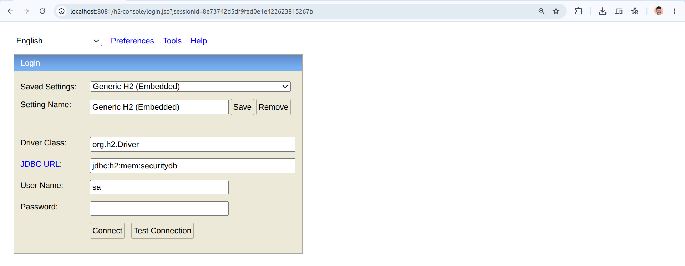
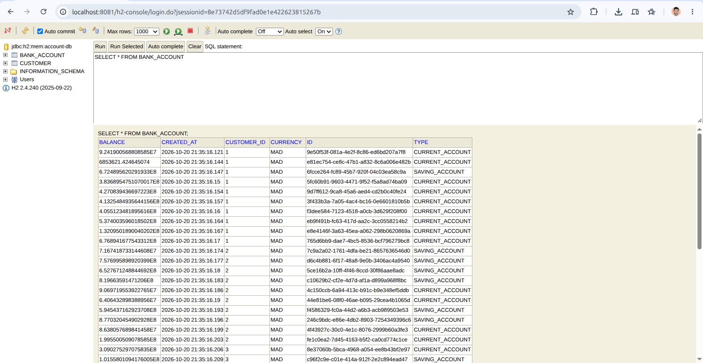
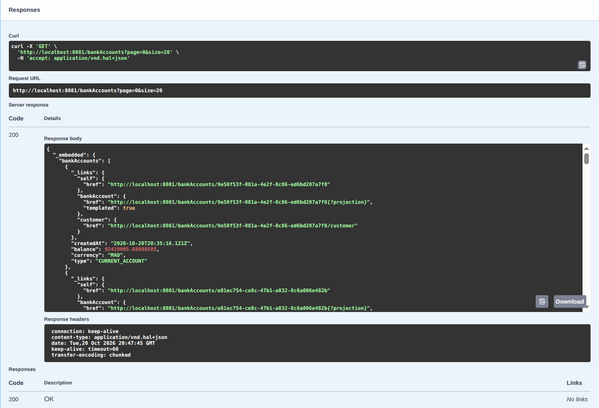
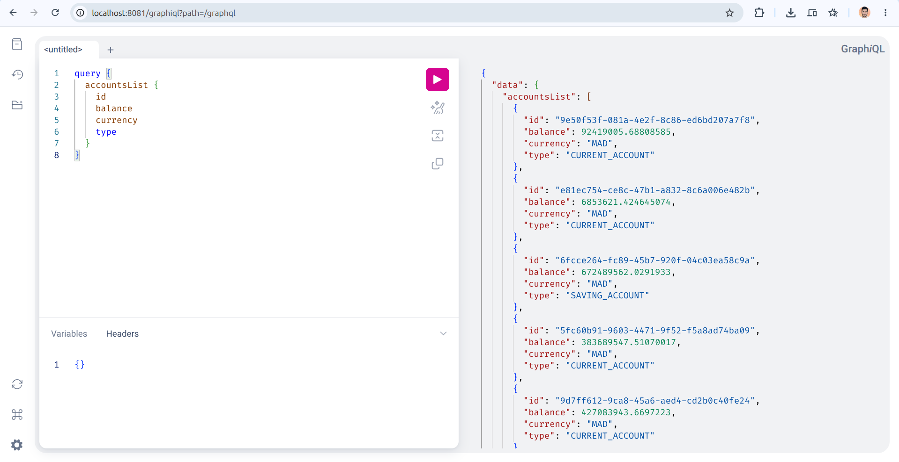
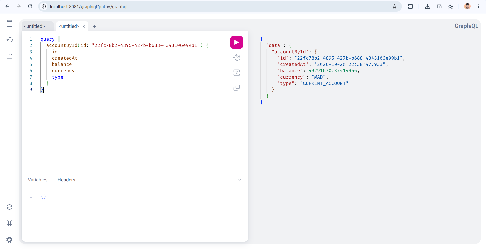

<a id="readme-top"></a>

<!-- =========================================================================
  DOCUMENTATION TECHNIQUE D'INGENIERIE LOGICIELLE
  Master Systemes Distribues et Intelligence Artificielle (SDIA) - ENSET Mohammedia
  Auteur : Yazid ESSOKTANI (http://essoktani.tech/)
  Projet : Bank Account Microservice (Activite Pratique N°2)
========================================================================= -->

<div align="center">

  <!-- Banniere superieure technique (capsule-render) -->
 
  <br />

  <!-- Metriques et Statuts du Depot -->
  <p>
    <a href="https://github.com/essoktani/bank-account-service">
      
    </a>
    <a href="LICENSE">
      
    </a>
    
  </p>

  <!-- Liens Professionnels & Identite Auteur -->
  <p>
    <a href="http://essoktani.tech/">
      
    </a>
    <a href="https://www.linkedin.com/in/yazid-essoktani-337549251/">
      
    </a>
    <a href="mailto:essoktani.yazid@gmail.com">
      
    </a>
  </p>

  <!-- Technologies Cles -->
  <p>
    
    
    
    
    
    
  </p>

  <!-- Navigation Rapide -->
  <p>
    <a href="#1-presentation-du-tp">Presentation</a> |
    <a href="#2-demarrage-rapide">Demarrage</a> |
    <a href="#3-guide-visuel-et-captures-decran">Guide des Captures</a> |
    <a href="#4-architecture-simplifiee">Architecture</a> |
    <a href="#5-contexte-academique">Contexte</a>
  </p>

</div>

<br />

<!-- =========================================================================
  CADRE DE CONTEXTE ACADEMIQUE ET INSTITUTIONNEL
========================================================================= -->
<div align="center">

| Contexte Academique & Institutionnel | Identification du Projet |
| :--- | :--- |
| **Etablissement :** ENSET Mohammedia, Universite Hassan II | **Auteur :** [Yazid ESSOKTANI](https://www.linkedin.com/in/yazid-essoktani-337549251/) |
| **Filiere :** Master Systemes Distribues & Intelligence Artificielle (SDIA) | **Encadrant :** Prof. Mohamed YOUSSFI |
| **Departement :** Mathematiques et Informatique | **Annee Universitaire :** 2026 / 2027 |
| **Module d'Enseignement :** Systemes Distribues et DevOps | **Version :** `v1.0.0` |

</div>

---

## Sommaire

<details open>
<summary><b>Afficher / Masquer la table des matieres</b></summary>

1. [Presentation du TP](#1-presentation-du-tp)
2. [Demarrage Rapide](#2-demarrage-rapide)
   - [Prerequis et Lancement](#21-prerequis-et-lancement)
   - [Points d'Acces Utiles](#22-points-dacces-utiles)
3. [Guide Visuel et Captures d'Ecran](#3-guide-visuel-et-captures-decran)
   - [Etape 1 : Persistance et Base H2](#etape-1--persistance-et-base-h2)
   - [Etape 2 : Documentation et API REST (Swagger UI)](#etape-2--documentation-et-api-rest-swagger-ui)
   - [Etape 3 : Spring Data REST et Projections](#etape-3--spring-data-rest-et-projections)
   - [Etape 4 : API Declarative GraphQL (GraphiQL)](#etape-4--api-declarative-graphql-graphiql)
   - [Etape 5 : Gestion des Exceptions GraphQL](#etape-5--gestion-des-exceptions-graphql)
   - [Etape 6 : Relation Client et Comptes](#etape-6--relation-client-et-comptes)
4. [Architecture Simplifiee](#4-architecture-simplifiee)
5. [Contexte Academique](#5-contexte-academique)

</details>

---

# 1. Presentation du TP

Ce travail pratique porte sur l'implementation d'un microservice de gestion de comptes bancaires (`bank-account-service`). L'objectif principal est de maitriser et comparer trois modes d'exposition d'API :

- **API REST conventionnelle :** Architecture en couches avec `Controller`, `Service`, `DTO` (`BankAccountRequestDTO`, `BankAccountResponseDTO`) et `Mapper`.
- **Spring Data REST :** Exposition automatique des entites JPA avec gestion des projections (`AccountProjection`).
- **Spring for GraphQL :** Requetage dynamique, schema SDL (`schema.graphqls`), requetes (`Query`), mutations (`Mutation`) et resolution des erreurs.

<p align="right"><a href="#readme-top">Haut de page</a></p>

---

# 2. Demarrage Rapide

### 2.1 Prerequis et Lancement

- **Prerequis :** Java 17+, Maven 3.8+.
- **Compilation et execution :**

```bash
# Compilation du projet
mvn clean compile

# Lancement de l'application
mvn spring-boot:run
```

### 2.2 Points d'Acces Utiles

| Outil / Interface | URL par Defaut | Role |
| :--- | :--- | :--- |
| **Swagger UI** | [http://localhost:8081/swagger-ui.html](http://localhost:8081/swagger-ui.html) | Documentation et test interactif de l'API REST |
| **OpenAPI Docs** | [http://localhost:8081/v3/api-docs](http://localhost:8081/v3/api-docs) | Specification brute OpenAPI en format JSON |
| **GraphiQL Console** | [http://localhost:8081/graphiql](http://localhost:8081/graphiql) | Editeur integre pour executer queries et mutations GraphQL |
| **Console H2** | [http://localhost:8081/h2-console](http://localhost:8081/h2-console) | Visualisation des tables et des donnees en memoire |
| **Endpoint REST** | [http://localhost:8081/api/bankAccounts](http://localhost:8081/api/bankAccounts) | Endpoints REST de base de l'application |
| **Spring Data REST** | [http://localhost:8081/bankAccounts](http://localhost:8081/bankAccounts) | Racine des ressources HATEOAS Spring Data REST |

<p align="right"><a href="#readme-top">Haut de page</a></p>

---

# 3. Guide Visuel et Captures d'Ecran

### Etape 1 : Persistance et Base H2

#### Capture 01 : Ecran de Connexion a la Console H2



---

#### Capture 02 : Visualisation des Tables et Donnees dans H2



---

### Etape 2 : Documentation et API REST (Swagger UI)

#### Capture 03 : Vue Generale de l'Interface Swagger UI


---

#### Capture 04 : Test de Creation de Compte via Swagger UI (POST)


---

#### Capture 05 : Test de Consultation des Comptes (GET)



---

### Etape 3 : Spring Data REST et Projections

#### Capture 06 : Exposition HATEOAS Standard (/bankAccounts)


---

#### Capture 07 : Test de la Projection p1 (AccountProjection)


---

### Etape 4 : API Declarative GraphQL (GraphiQL)

#### Capture 08 : Interface GraphiQL et Explorateur de Schema


---

#### Capture 09 : Requete GraphQL Query (accountsList)



---

#### Capture 10 : Requete GraphQL par Identifiant (bankAccountById)



---

#### Capture 11 : Mutation GraphQL d'Ajout de Compte (addAccount)


---

### Etape 5 : Gestion des Exceptions GraphQL

#### Capture 12 : Test de Resolution d'Erreur (Compte Inexistant)


---

### Etape 6 : Relation Client et Comptes

#### Capture 13 : Consultation des Clients et de Leurs Comptes Associes


<p align="right"><a href="#readme-top">Haut de page</a></p>

---

# 4. Architecture Simplifiee

Le schema suivant resume de facon directe les differents flux de communication vers la couche de donnees :

```mermaid
flowchart TD
    Client["Client HTTP / Navigateur / Mobile"]

    subgraph Endpoints["Points d'Entree du Microservice"]
        REST["API REST Conventionnelle<br/>/api/bankAccounts"]
        DataREST["Spring Data REST & Projections<br/>/bankAccounts"]
        GQL["Spring for GraphQL<br/>/graphql"]
    end

    subgraph Metier["Couche Service & Metier"]
        Service["AccountService & AccountMapper<br/>(Gestion DTOs & Validation)"]
    end

    subgraph Persistance["Couche Acces aux Donnees"]
        Repo["Spring Data JPA<br/>(BankAccountRepository, CustomerRepository)"]
        H2[("Base de Donnees H2<br/>(In-Memory)")]
    end

    Client --> REST
    Client --> DataREST
    Client --> GQL

    REST --> Service
    GQL --> Service
    GQL --> Repo
    DataREST --> Repo

    Service --> Repo
    Repo --> H2

    style Client fill:#f6f8fa,stroke:#d0d7de,stroke-width:1px,color:#24292f;
    style Endpoints fill:#ffffff,stroke:#0969da,stroke-width:2px,color:#24292f;
    style Metier fill:#f6f8fa,stroke:#d0d7de,stroke-width:1px,color:#24292f;
    style Persistance fill:#f6f8fa,stroke:#1f883d,stroke-width:1px,color:#24292f;
```



<p align="right"><a href="#readme-top">Haut de page</a></p>
