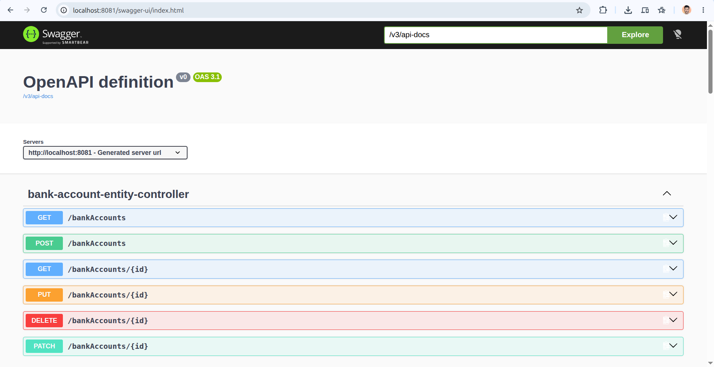
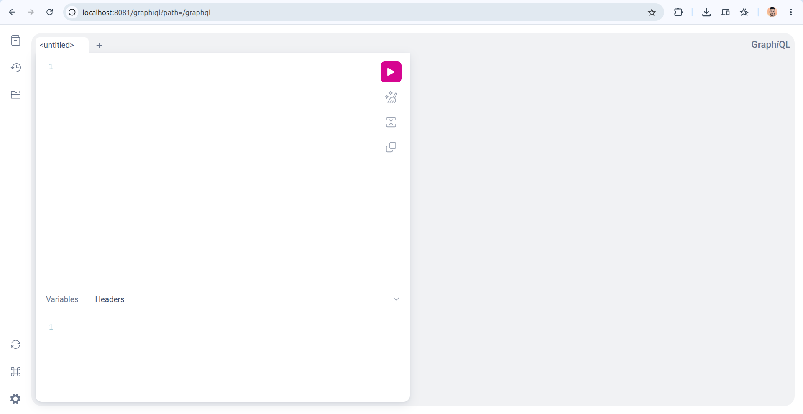
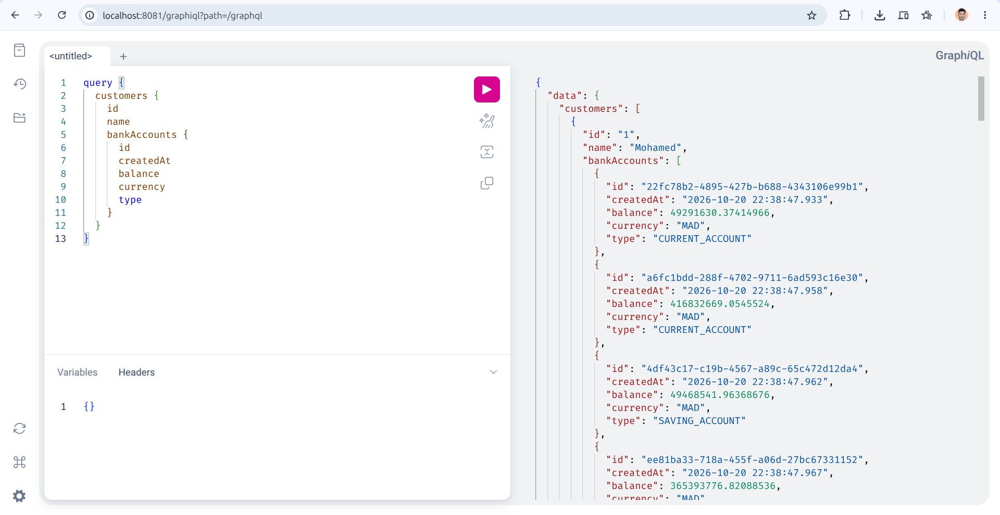
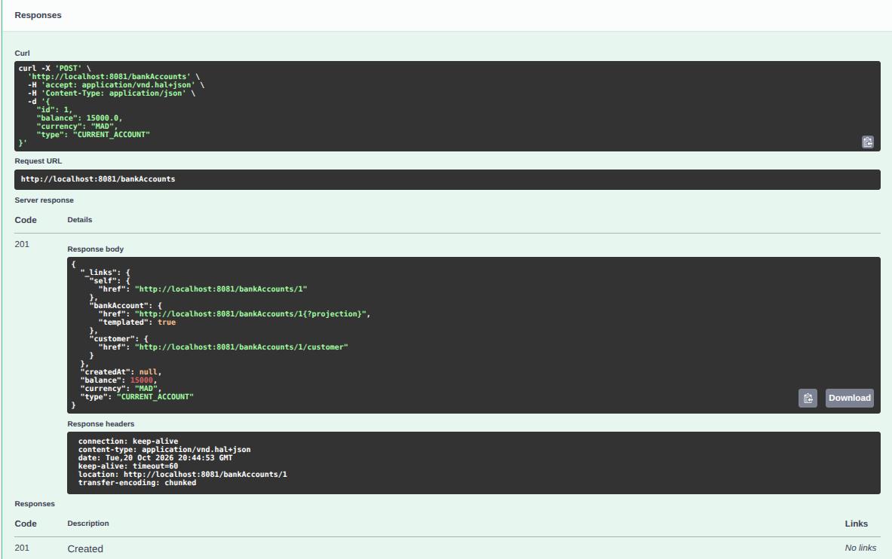
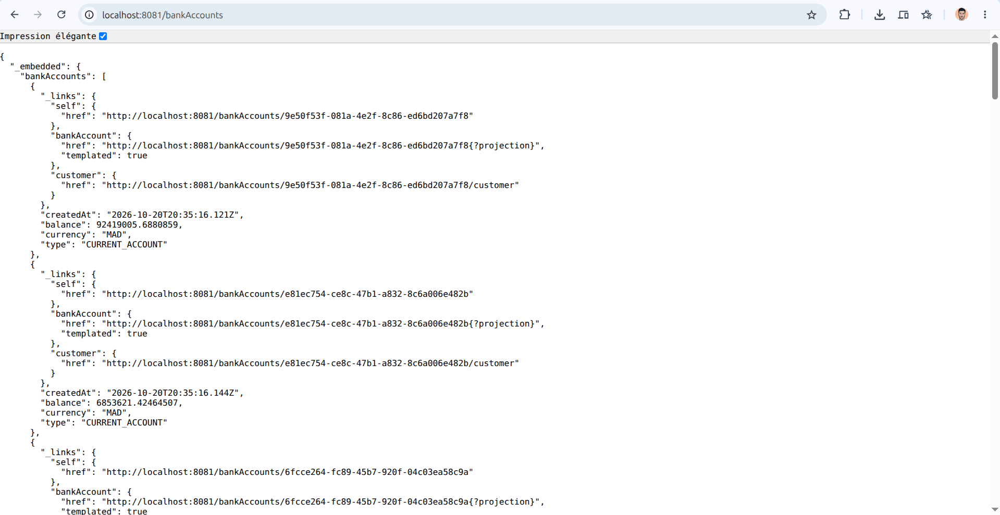
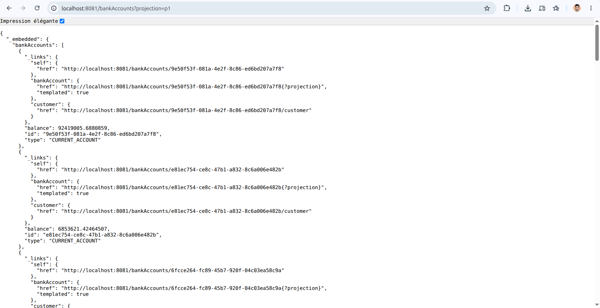
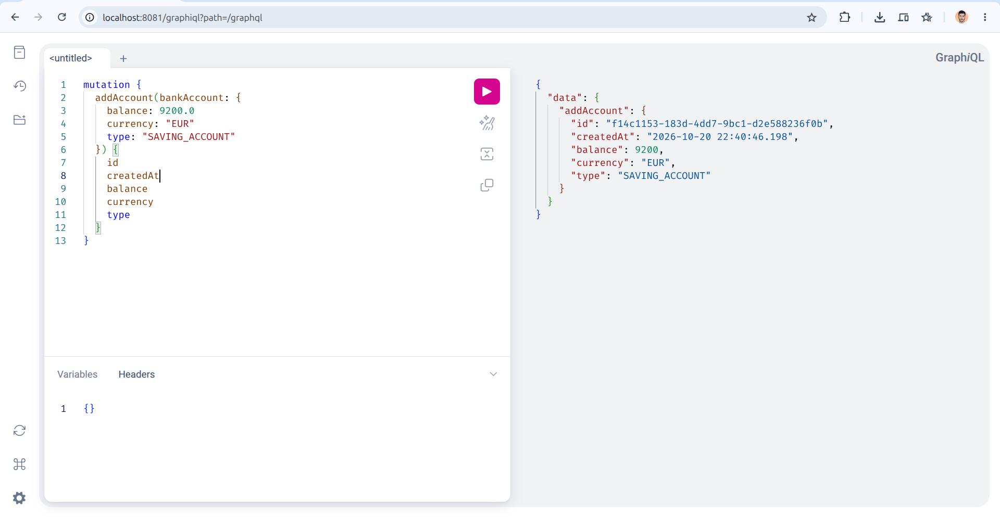
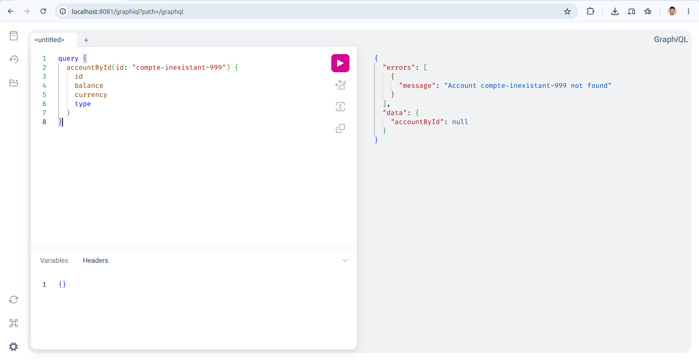

<div align="center">
  <!-- En-tête créatif -->
  

  <!-- Animation texte ciblant "Ce que fait le projet" et "Pourquoi c'est utile" -->
  

  <br/>

  <!-- Badges recommandés par GitHub -->
  <p>
    
    
</div>

---

<!-- 1. CE QUE FAIT LE PROJET -->
## À propos du projet

**bank-account-service** est une solution **microservice backend** développée avec **Spring Boot 3** conçue pour la **gestion complète et évolutive de comptes bancaires et de clients**. Elle permet aux **développeurs et applications clientes** de manipuler les opérations sur les comptes (création, consultation, mise à jour, suppression) à travers plusieurs paradigmes d'exposition modernes (**REST avec DTOs**, **Spring Data REST hypermédia HATEOAS**, et **GraphQL**) sans avoir à multiplier les couches d'intégration manuelles ou à subir des frictions de format.

> [!NOTE]
> Pour une vue détaillée des choix de conception et des schémas système, consultez la [documentation d'architecture](docs/ARCHITECTURE.md).

<!-- APERÇU VISUEL (CAPTURES D'ÉCRAN) -->
### Aperçu en action

<div align="center">
  <!-- Image principale Swagger UI -->
  
  <p><em>Vue d'ensemble de l'interface interactive Swagger UI exposant les endpoints REST du service de comptes bancaires</em></p>
</div>

<details>
  <summary><b>Voir plus de captures d'écran (Swagger, GraphQL, Spring Data REST & H2)</b></summary>
  <br/>
  
  <table width="100%">
    <tr>
      <td width="50%" align="center">
        <b>Interface GraphiQL & Requêtes GraphQL</b><br/><br/>
        
      </td>
      <td width="50%" align="center">
        <b>Requête GraphQL avec relations Customer</b><br/><br/>
        
      </td>
    </tr>
    <tr>
      <td width="50%" align="center">
        <b>Création de compte via Swagger UI (POST)</b><br/><br/>
        
      </td>
      <td width="50%" align="center">
        <b>Consultation des comptes via Swagger UI (GET)</b><br/><br/>
        
      </td>
    </tr>
    <tr>
      <td width="50%" align="center">
        <b>Spring Data REST (HAL / HATEOAS)</b><br/><br/>
        
      </td>
      <td width="50%" align="center">
        <b>Spring Data REST avec Projections (p1)</b><br/><br/>
        
      </td>
    </tr>
    <tr>
      <td width="50%" align="center">
        <b>Mutation GraphQL (addAccount)</b><br/><br/>
        
      </td>
      <td width="50%" align="center">
        <b>Gestion des exceptions GraphQL</b><br/><br/>
        
      </td>
    </tr>
    <tr>
      <td width="50%" align="center">
        <b>Console H2 Database (Connexion)</b><br/><br/>
        
      </td>
      <td width="50%" align="center">
        <b>Tables et Données H2 (BANK_ACCOUNT & CUSTOMER)</b><br/><br/>
        
      </td>
    </tr>
  </table>
</details>

<!-- 2. POURQUOI LE PROJET EST UTILE -->
## Pourquoi utiliser ce projet ?

Ce projet démontre l'implémentation de multiples paradigmes d'APIs au sein d'un même microservice bancaire :

- **Triple paradigme d'API (REST, Spring Data REST, GraphQL) :** Offre le choix du protocole le plus adapté : REST standard avec DTOs pour les intégrations tierces strictes, Spring Data REST hypermédia (HAL) avec projections pour la navigation guidée, et GraphQL pour des requêtes personnalisées sans sur-récupération (*over-fetching*).
- **Architecture en couches découplée :** Séparation claire entre les contrôleurs Web, la logique métier transactionnelle (`@Service`), les mappers dédiés (`AccountMapper`), les DTOs et les repositories Spring Data JPA.
- **Documentation et Outillage interactifs intégrés :** Console Swagger UI OpenAPI, interface interactive GraphiQL et console de base de données en mémoire H2 préconfigurées pour un cycle de développement et de test immédiat.

### Stack Technique

| Couche | Technologies |
| :--- | :--- |
| **Backend & Framework** | `Java 17`, `Spring Boot 3`, `Spring Web MVC` |
| **Exposition API** | `Spring Data REST (HAL / HATEOAS)`, `Spring GraphQL`, `Springdoc OpenAPI / Swagger UI 3` |
| **Persistance & Données** | `Spring Data JPA`, `Hibernate`, `H2 Database (In-Memory)` |
| **Boilerplate & Qualité** | `Lombok`, `AccountMapper` (Pattern DTO), `Maven` |

<!-- 3. COMMENT DÉMARRER -->
## Pour commencer

Suivez ces instructions pour déployer et exécuter une instance locale du projet pour le développement et les tests.

### Prérequis

Assurez-vous d'avoir installé les outils suivants sur votre environnement :

- `Java JDK` (v17 ou supérieur)
- `Apache Maven` (v3.8+ ou utilisation du wrapper `./mvnw`)
- `Git` pour le contrôle de version

### Installation

1. **Cloner le dépôt**
   ```bash
   git clone https://github.com/essoktani-yazid/spring-boot-microservice-tp1.git
   cd spring-boot-microservice-tp1
   ```

2. **Configuration (`application.properties`)**
   L'application est préconfigurée dans `src/main/resources/application.properties` :
   - Port d'écoute : `8081`
   - URL base de données H2 : `jdbc:h2:mem:account-db`
   - Console H2 : activée (`/h2-console`)
   - GraphiQL : activé (`/graphiql`)

3. **Démarrer l'application**
   ```bash
   # Sous Linux / macOS
   ./mvnw spring-boot:run

   # Sous Windows
   mvnw.cmd spring-boot:run
   ```

### Exemple d'utilisation

Une fois le service démarré, l'application est accessible sur `http://localhost:8081`. Voici des exemples d'appels :

#### 1. API REST Standard
```bash
# Récupérer la liste des comptes bancaires
curl -X GET http://localhost:8081/api/bankAccounts

# Créer un nouveau compte bancaire
curl -X POST http://localhost:8081/api/bankAccounts \
  -H "Content-Type: application/json" \
  -d '{"balance": 12500.0, "currency": "MAD", "type": "CURRENT_ACCOUNT"}'
```

#### 2. API GraphQL
Accessible via l'interface interactive `http://localhost:8081/graphiql` ou par requête HTTP POST :
```bash
curl -X POST http://localhost:8081/graphql \
  -H "Content-Type: application/json" \
  -d '{"query": "query { accountsList { id balance currency type customer { id name } } }"}'
```

#### 3. Spring Data REST & Projections
```bash
# Navigation hypermédia HAL
curl -X GET http://localhost:8081/bankAccounts

# Utilisation de la projection p1 (id, type, balance)
curl -X GET "http://localhost:8081/bankAccounts?projection=p1"
```

*Pour découvrir l'ensemble des endpoints et paramètres disponibles, consultez la [Référence API complète](docs/API.md).*

### Structure du projet

```text
.
├── docs/
│   ├── assets/                      # Captures d'écran (Swagger, GraphQL, H2, REST)
│   ├── API.md                       # Documentation exhaustive des endpoints
│   └── ARCHITECTURE.md              # Conception, diagrammes et modèle de données
├── src/
│   ├── main/
│   │   ├── java/org/essoktani/bank_account_service/
│   │   │   ├── dto/                 # DTOs de requête et de réponse (BankAccountRequestDTO, BankAccountResponseDTO)
│   │   │   ├── entities/            # Entités JPA (BankAccount, Customer) & Projection (AccountProjection)
│   │   │   ├── enums/               # Énumération des types de comptes (AccountType)
│   │   │   ├── exceptions/          # Résolveur d'erreurs GraphQL personnalisé
│   │   │   ├── mappers/             # Conversion DTO <-> Entité (AccountMapper)
│   │   │   ├── repositories/        # Repositories JPA & Spring Data REST (BankAccountRepository, CustomerRepository)
│   │   │   ├── service/             # Couche service métier transactionnelle (AccountService, AccountServiceImpl)
│   │   │   ├── web/                 # Contrôleurs REST et GraphQL (AccountRestController, BankAccountGraphQLController)
│   │   │   └── BankAccountServiceApplication.java # Point d'entrée & initialisation des données
│   │   └── resources/
│   │       ├── graphql/
│   │       │   └── schema.graphqls  # Schéma SDL GraphQL
│   │       └── application.properties # Configuration (port 8081, H2, GraphiQL)
│   └── test/                        # Tests unitaires et d'intégration
├── pom.xml                          # Dépendances Maven et configuration du projet
├── LICENCE                          # Licence MIT
└── README.md                        # Documentation principale du projet
```

<!-- 4. AIDE & SUPPORT -->
## Aide et Support

Vous avez une question sur l'architecture ou l'implémentation du projet ?
- **Documentation :** Consultez les fichiers techniques présents dans le dossier [`docs/`](docs/).
- **Contact direct :** N'hésitez pas à me contacter directement via LinkedIn ou mon portfolio.

<!-- 5. CONTRIBUTION & AUTEUR -->
## Contribuer

Les contributions et propositions d'améliorations sont les bienvenues !
1. **Forkez** le projet
2. Créez votre branche de fonctionnalité (`git checkout -b feature/NouvelleFonctionnalite`)
3. Commitez vos changements (`git commit -m 'feat: Ajout de NouvelleFonctionnalite'`)
4. Pushez vers la branche (`git push origin feature/NouvelleFonctionnalite`)
5. Ouvrez une **Pull Request**

## Auteur

<div align="center">

**Yazid ESSOKTANI**  
*Full-Stack Web & AI Developer*

[](https://www.essoktani.tech/)
[](https://www.linkedin.com/in/yazid-essoktani-337549251)
[](https://github.com/essoktani-yazid)

</div>

---

## Licence

Distribué sous la licence **MIT**. Consultez le fichier [`LICENCE`](LICENCE) pour plus d'informations.
