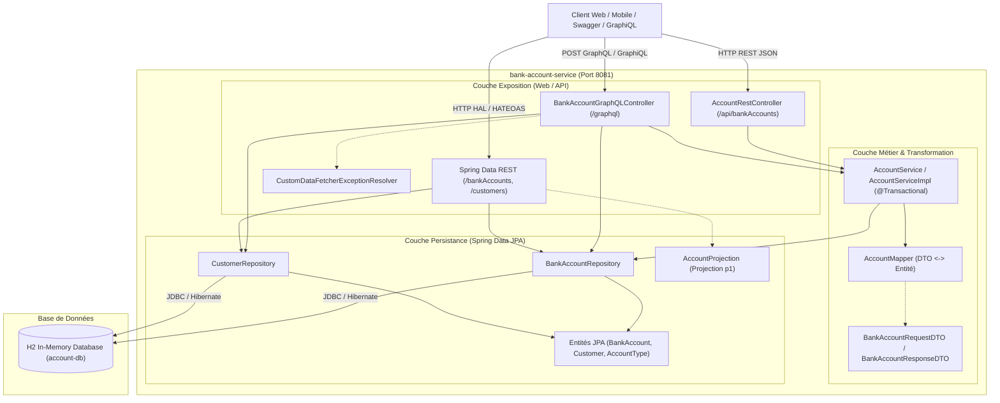
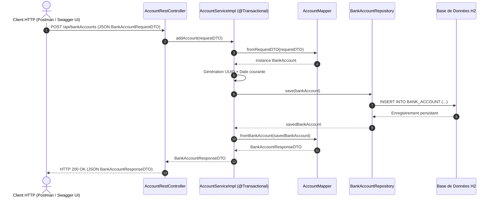
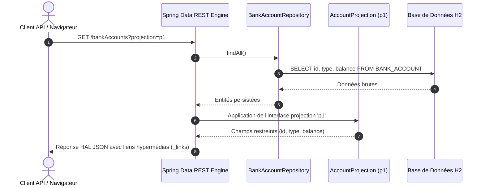
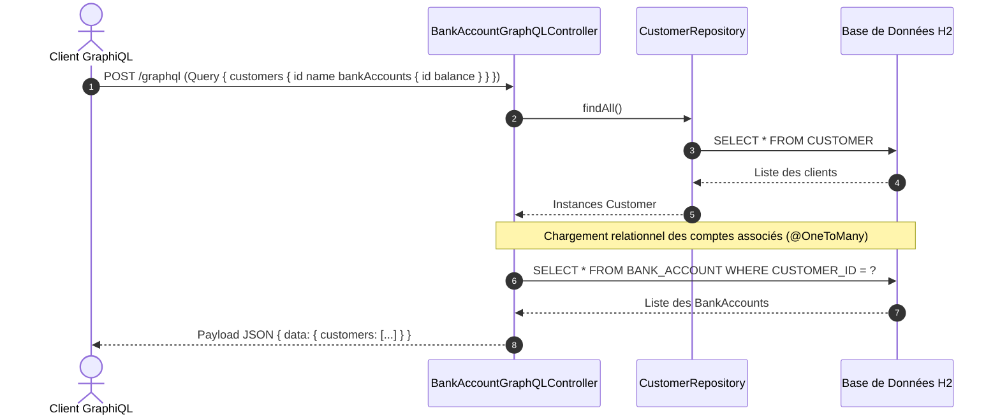
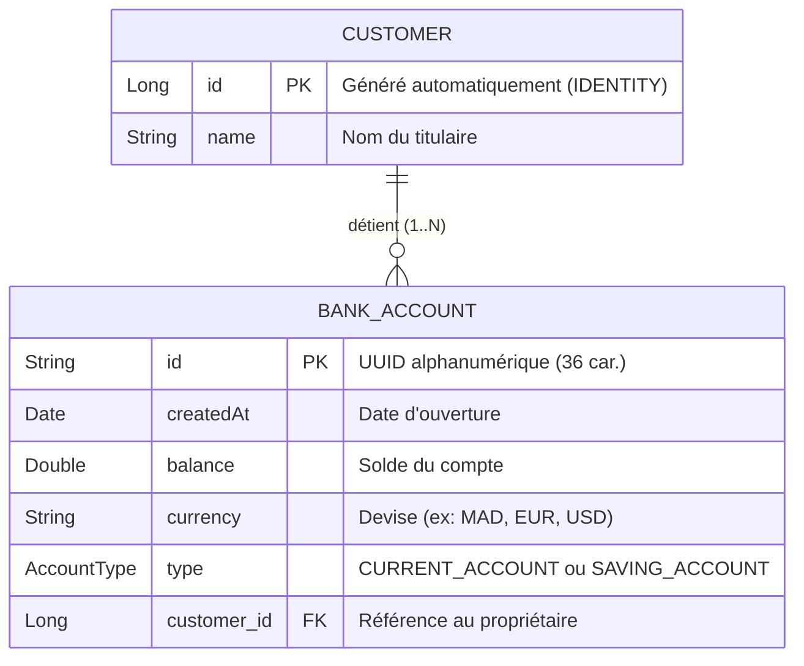

# Architecture du Système — bank-account-service

> Ce document décrit l'architecture technique, les choix de conception et les flux de données de **bank-account-service**.

---

## 1. Vue d'ensemble (High-Level Design)

L'application repose sur une **architecture microservice en couches (Layered Architecture)** et le pattern **Service-Repository**, enrichie d'une **stratégie multi-paradigmes d'exposition d'APIs**. Elle permet d'accéder aux mêmes ressources métier via trois canaux distincts et complémentaires :
1. **API REST Métier** basée sur des DTOs et un contrôleur Spring MVC standard.
2. **API Hypermédia (Spring Data REST / HAL)** générée automatiquement à partir des repositories JPA avec support de projections HATEOAS.
3. **API GraphQL** orientée graphe permettant des requêtes sur-mesure et la navigation fluide entre entités sans sur-récupération (*over-fetching*).



---

## 2. Composants Principaux

| Composant | Technologie | Rôle & Responsabilités |
| :--- | :--- | :--- |
| **Contrôleur REST** | `AccountRestController` (Spring Web MVC) | Expose les endpoints REST standards sur `/api/bankAccounts` en utilisant des DTOs pour isoler les entités internes. |
| **Contrôleur GraphQL** | `BankAccountGraphQLController` (Spring GraphQL) | Gère les queries (`accountsList`, `accountById`, `customers`) et mutations (`addAccount`, `updateAccount`, `deleteAccount`) définies dans le schéma SDL. |
| **Gestionnaire d'Erreurs GraphQL** | `CustomDataFetcherExceptionResolver` | Intercepte les exceptions d'exécution (ex: compte introuvable) et fournit un message d'erreur clair dans le payload GraphQL. |
| **Hypermédia & Projections** | Spring Data REST & `AccountProjection` | Expose automatiquement des endpoints HAL (`/bankAccounts`, `/customers`) avec navigation hypermédia et projection partielle `p1`. |
| **Couche Service** | `AccountService` & `AccountServiceImpl` | Implémente la logique métier transactionnelle (`@Transactional`), l'assignation d'identifiants UUID et l'orchestration des mappers. |
| **Couche Mapping** | `AccountMapper` | Assure la conversion bidirectionnelle découplée entre `BankAccountRequestDTO`, `BankAccount` et `BankAccountResponseDTO`. |
| **Accès aux Données** | `BankAccountRepository` & `CustomerRepository` | Interfaces Spring Data JPA fournissant les opérations CRUD, la pagination et les requêtes dérivées (ex: `findByType`). |
| **Base de Données** | H2 In-Memory (`account-db`) | Base de données relationnelle en mémoire pour le stockage rapide et les tests sans infrastructure externe lourde. |

---

## 3. Flux de données (Data Workflow)

### Flux 1 : Création d'un compte bancaire via l'API REST Métier

Le diagramme ci-dessous illustre le traitement complet d'une requête de création de compte bancaire :



### Flux 2 : Consultation avec projection via Spring Data REST



### Flux 3 : Exécution d'une requête GraphQL avec relation Customer



---

## 4. Modèle de données & Stockage

### Modèle Relationnel (Entités JPA)

Le système modélise deux entités principales reliées par une relation bidirectionnelle 1 à N :



### Détails des entités et relations

- **`Customer` :**
  - Identifiant unique numérique auto-incrémenté (`Long id`).
  - Nom du client (`String name`).
  - Liste de comptes associés (`List<BankAccount> bankAccounts`), annotée avec `@OneToMany(mappedBy = "customer")`. L'annotation `@JsonProperty(access = JsonProperty.Access.WRITE_ONLY)` prévient la récursion infinie lors de la sérialisation JSON REST.
- **`BankAccount` :**
  - Identifiant UUID généré côté serveur (`String id`).
  - Date de création (`Date createdAt`).
  - Solde (`Double balance`) et devise (`String currency`).
  - Type de compte (`AccountType type` : `CURRENT_ACCOUNT` ou `SAVING_ACCOUNT`), persisté en base sous forme de chaîne de caractères (`@Enumerated(EnumType.STRING)`).
  - Relation plusieurs-à-un vers le client (`@ManyToOne Customer customer`).

### Initialisation automatique des données

Au démarrage de l'application, un bean `CommandLineRunner` initialise la base H2 avec un jeu de données de test :
- Création de 4 clients : `Mohamed`, `Yassine`, `Hanae`, `Imane`.
- Génération de 10 comptes bancaires pour chaque client avec des soldes aléatoires et une répartition mixte entre comptes courants et d'épargne en devise `MAD`.

---

## 5. Sécurité, Configuration & Déploiement

- **Configuration de l'environnement (`application.properties`) :**
  - Nom de l'application : `bank-account-service`
  - Port d'écoute : `8081`
  - Source de données : `jdbc:h2:mem:account-db` (in-memory)
  - Console H2 : accessible sur `/h2-console`
  - GraphiQL : activé sur `/graphiql`
- **Sécurité :**
  - Environnement de développement libre sans contrainte d'authentification pour faciliter l'exploration et les tests rapides des trois interfaces d'API.
- **Build et Exécution :**
  - Compilé avec **Java 17** et **Maven**.
  - Packaging d'un artefact JAR exécutable autonome :
    ```bash
    ./mvnw clean package
    java -jar target/bank-account-service-0.0.1-SNAPSHOT.jar
    ```

---
[⬅ Retour au README principal](../README.md)
